<!-- ================= HERO ================= -->

<picture>
  <source media="(prefers-color-scheme: light)" srcset="https://www.gitskins.com/api/section/hero?username=nimsarawickramarathna&theme=aurora&avatar=https%3A%2F%2Favatars.githubusercontent.com%2Fu%2F201961874%3Fv%3D4&variant=living-identity&label=Nimsara%20Wickramarathna&v=wow-living-identity-1&mode=light">
  
</picture>

<b>BUILD &nbsp;•&nbsp; LEARN &nbsp;•&nbsp; CREATE</b>

 

---

<!-- ================= ABOUT ================= -->

### About

Data Science undergraduate with a focus on turning data into working solutions. 
I build projects across analytics, machine learning, AI and software development, 
and I'm always improving my skills by shipping something real.

 

<!-- ================= TECHNICAL FOCUS ================= -->

### Technical Focus

<table>
  <tr>
    <td align="center" width="200"><b>Data Science &amp; Analytics</b></td>
    <td align="center" width="200"><b>Machine Learning &amp; Prediction</b></td>
    <td align="center" width="200"><b>Artificial Intelligence</b></td>
  </tr>
  <tr>
    <td align="center" width="200"><b>Data Visualization &amp; BI</b></td>
    <td align="center" width="200"><b>Software &amp; Web Development</b></td>
    <td align="center" width="200">Always learning</td>
  </tr>
</table>

 

<!-- ================= LANGUAGES ================= -->

 

<!-- ================= FEATURED PROJECTS ================= -->

### Featured Projects

<table>
  <tr>
    <td valign="top" width="420">
      <b><a href="https://github.com/NimsaraWickramarathna/Hotel-Booking-SSIS-SSAS-PowerBI">Hotel Booking Analytics</a></b> 
      Business intelligence solution for hotel booking data.  
      <code>SSIS</code> <code>SSAS</code> <code>Power BI</code>
    </td>
    <td valign="top" width="420">
      <b><a href="https://github.com/NimsaraWickramarathna/fuel-efficiency-prediction">Fuel Efficiency Prediction</a></b> 
      Machine learning model that predicts vehicle fuel efficiency.  
      <code>Machine Learning</code> <code>Prediction</code>
    </td>
  </tr>
  <tr>
    <td valign="top" width="420">
      <b><a href="https://github.com/NimsaraWickramarathna/Gold-Price-Prediction">Gold Price Prediction</a></b> 
      Predictive modeling project for gold price forecasting.  
      <code>Machine Learning</code> <code>Forecasting</code>
    </td>
    <td valign="top" width="420">
      <b><a href="https://github.com/NimsaraWickramarathna/BankKMS">BankKMS</a></b> 
      Agentic AI and secure knowledge management.  
      <code>Agentic AI</code> <code>Knowledge Management</code>
    </td>
  </tr>
  <tr>
    <td valign="top" width="420">
      <b><a href="https://github.com/NimsaraWickramarathna/Gemzyne">Gemzyne</a></b> 
      Gemstone marketplace built on the MERN stack.  
      <code>MongoDB</code> <code>Express</code> <code>React</code> <code>Node.js</code>
    </td>
    <td valign="top" width="420">
      <b><a href="https://github.com/NimsaraWickramarathna?tab=repositories">More on GitHub</a></b> 
      Browse all repositories.
    </td>
  </tr>
</table>

 

<!-- ================= ACTIVITY ================= -->

 

<!-- ================= TIMELINE ================= -->

 

---

<!-- ================= CONNECT ================= -->

### Connect

  

✦ BUILDING IDEAS INTO REALITY ✦

